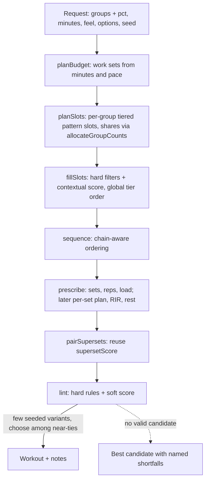

# Gainz: procedural generation brainstorm (2026-11-17)

## Context

Gainz is a single 1,531-line `index.html` (vanilla JS, no build, no tests), byte-identical to the live GitHub Pages site. The last commit removed about 620 lines of live logging, rest timer and drop-set tracking, so the product is already *generate, copy to Apple Notes, train*. This document answers one question: how to make the generated workout read like a coach wrote it. No app code changes in this session.

Evidence labels used below: **measured** = 2,000 simulated generations per configuration in headless Chromium; **read** = from the code; **assumed** = not verified.

Decisions you made in this session:
- You pick the muscle groups yourself. The generator gets smarter about that selection; named split presets are not the primary input.
- Split into plain ES modules with `node --test`. No build step.
- Library grows by every lift in your logs plus about 27 commercial-gym staples, without review.
- Tapping Copy is the signal that a workout was done.

---

## 1. Current-state assessment

**Works well (read)**
- The Apple Notes copy format (`notesText()`), including your `45's` / `ea` notation and blank `x ` rep lines. This is the real product surface.
- `supersetScore()` is good rule-based coaching logic. It blocks high-fatigue lifts and overlapping prime movers and rewards antagonists and shared equipment. It is the template for how selection rules should be written.
- `PAIR_META` already holds `pattern`, `equipment` and `fatigue` for all 55 exercises. Only the superset scorer reads it.
- `allocateGroupCounts()` and `normalizePercentages()` (largest-remainder allocation), the corrective and warm-up caps, and `exclusive` as a primitive redundancy rule.
- Several helpers already take an `rng` argument, so seeded generation is half wired.

**Limits**

| Area | Finding |
|---|---|
| Selection (measured) | Uniform random inside a muscle group; pattern ignored. Chest 30 min has 4+ presses in 100% of runs. Chest 60 min has one possible workout (it asks for 9 lifts from a pool of 7). Back 30 min has 3+ vertical pulls in 67%. Legs 15 min has no hinge and no leg curl in 26%. Legs 30 min pairs Bulgarian split squats with walking lunges in 59%. Chest/shoulders/triceps 60 min always has bench and barbell OHP together, 5+ presses, and no lateral raise in 61%. |
| Sequencing (measured) | Groups in fixed UI order, compounds then isolations inside each group, random order among compounds. On the push mix an isolation precedes a compound in 100% of runs. Deadlift is not first in about 80% of back sessions that contain it. With supersets on, `organizeSupersets()` re-sorts the list, so order quality depends on an unrelated toggle. |
| Time (read) | No time model. Exercise count is fixed at 4/6/9 and sets depend only on duration, feel and compound/isolation, giving about 8/16/32 sets. "Good" adds a set to every compound with no time check (60 min Good = 37 sets). Your pace is unknown: two logged sessions tagged 30 min have 12 and 23 sets, and that tag may be the generator setting rather than elapsed time, so the pace must be one tunable constant. |
| Prescription (read) | One scalar load per exercise, so every set is the same weight. Your logs show ramping sets to a top set and drop sets on the last set. No RIR, no rest. Loads round to 5 lb while your stacks move in 12 lb steps. |
| Loads go stale (read) | `suggestWeight()` reads `DB.last`, which only updates in `logWorkout()`. Since you track in Notes, loads are frozen at the July import, or drift +4% each time "Good" is logged. |
| Variety (measured) | No memory. Consecutive regenerations overlap 54% by chance. Regenerate rerolls everything; no lock or swap. |
| Data (read) | Machine chest press, goblet squat, push-ups and upright row are tagged isolation. Incline DB press is tagged the same pattern as flat bench. Straight-arm pulldown counts as a vertical pull. Core has 14 exercises, chest 7, biceps 4, calves 3. Eleven lifts from your own logs are missing. |
| Engineering (read) | `generate()` reads the DOM and global state and calls `Math.random()` directly. It cannot be unit-tested or reproduced. |

## 2. Product direction

Gainz should become a **personal session writer**: you name the muscles and the time, and it returns a session that is coherent, ordered, sized to the time, and written in your Notes format. Three shifts get it there.

1. **Random draw to slot design.** Each muscle group owns a prioritized list of movement slots; a contextual scorer fills them given what is already in the session.
2. **Exercise count to set budget.** Time buys sets. Exercise count becomes an output.
3. **Stateless to lightly stateful.** Copy records exercises and edited loads. That alone enables rotation, anchors and current weights, with no logging feature.

Deliberately not pursued now: a five-way goal selector. Your logs are uniformly hypertrophy-style and the library's rep ranges already encode that. A goal-by-role matrix adds a setting that would rarely change the output for you. Readiness already exists as the feel control. If wanted later, one "strength bias" toggle (heavier anchors, longer rest, fewer accessories) covers most of the value.

## 3. Top 10 developments (ranked)

| # | Development | Quality impact | Effort | Leverage |
|---|---|---|---|---|
| 1 | Pattern-aware tiered slot selection with session-context scoring | Very high | M | Very high |
| 2 | Sequencing pass (muscle-chain ordering, heavy and unstable lifts early, core last) | High | S | High |
| 3 | Exercise data consolidation, tag fixes, +11 logged lifts, +27 staples | High | M | Prerequisite |
| 4 | Linter as property tests over seeds (engine extracted to modules) | Indirect, high | S-M | Very high |
| 5 | Set budget from time, single pace constant, 45 min option | High | S | High |
| 6 | Prescriptions that match how you train: per-set plan (ramp, top set, back-off or drop), RIR, rest, equipment-true load steps | High | M | Medium |
| 7 | Copy-time memory: edited loads persist, anchors stay, accessories rotate with a cooldown | High over weeks | S-M | High |
| 8 | Per-exercise controls: swap within slot, lock, regenerate one, add or remove a set, hide forever; re-lint after edits | Medium-high | M | Medium |
| 9 | Time-fit v2 and intensity budget: supersets chosen as a compression tool rather than a toggle; at most one or two drop sets, only on the last set of a stable isolation, never on deload | Medium | M | Medium |
| 10 | Minimal profile: one priority muscle, limitation toggles (overhead, spinal load, hanging), favorites | Medium | S-M | Medium |

Low priority by design: goal selector, named split preset chips, recovery tracking beyond what Copy memory gives for free, any runtime LLM.

## 4. Top 3 next moves

**Move 1: Generation Core** (items 1 to 5; complexity M-L, three commits)
- *Does:* tiered slot selection, sequencing, set budget, consolidated and enlarged library, linter-backed tests.
- *Why:* fixes every measured defect above. Nothing later is worth building on random selection.
- *Builds on:* `PAIR_META`, `allocateGroupCounts()`, `canShareWorkout()`, `supersetScore()` as the scoring style, `notesText()` unchanged.
- *Unlocks:* swap is "refill this slot"; compression is "replan with a smaller budget"; the linter becomes the edit guardrail.

**Move 2: Prescriptions and time-fit** (items 6 and 9; complexity M)
- *Does:* per-set plans, RIR and rest by role, 12 lb stack steps, correct direction for assistance loads, supersets and drop sets used on purpose.
- *Why:* this is what makes the page look coach-written rather than merely well selected.
- *Builds on:* `buildItem()`, `suggestWeight()`, `roundInc()`, the superset functions. Requires replacing scalar `it.w` with a per-set array in render, notes and history, and relaxing the equal-sets gate in `supersetScore()`.
- *Unlocks:* honest duration estimates and intensity-technique rules.

**Move 3: Copy memory and per-exercise control** (items 7 and 8; complexity M)
- *Does:* `copyNotes()` records exercise ids and any edited loads; anchors persist, accessories avoid the last copied pick; swap, lock, hide.
- *Why:* fixes stale loads with zero extra steps and delivers variety without randomness.
- *Builds on:* `copyNotes()`, `DB.last`, the existing editable weight inputs.
- *Unlocks:* a visible check status that can actually fail, and "trained recently" awareness.

## 5. Architecture

Your proposed pipeline is close. Three changes: the time budget moves to the front (plan to fit, rather than generate and trim), filtering and weighted selection merge into one contextual slot-fill, and validation wraps the loop as well as ending it.

- **Primitive:** per-muscle-group slot lists with tiers (core, secondary, optional) and pattern alternatives. Example for legs: knee-dominant compound, hip-dominant, knee flexion, unilateral, knee extension. Hand-written per-day blueprints were rejected because your sessions are mixed and the sliders produce requests no blueprint covers.
- **Split coherence** comes from session-level rules in the scorer (press cap across chest and shoulders, one heavy hinge, no synergist pre-fatigue), which work for any mix you pick.
- **Candidates:** generate a handful of seeded variants from the constructive generator and choose among near-ties by seed. This is a wrapper, not a substitute for good construction.
- **Purity:** `generateWorkout(request, ctx)` takes `lib`, stored loads and a seeded RNG. `generate()` shrinks to reading controls, calling the engine and rendering.
- **Files:** `index.html` (UI), `js/exercises.js`, `js/engine.js`, `tests/engine.test.js`, a three-line `package.json`.
- **AI:** none at runtime. A static site cannot hold an API key safely, and rules are sufficient. Useful at development time for authoring and reviewing exercise metadata, and later for parsing a pasted Notes log if you ever want real progression.

## 6. "Gainz Verified"

**Build the linter. Do not ship the badge yet.**

A badge on a workout that passes by construction only says the code agrees with itself. It carries information in exactly two situations: the request is infeasible (15 minutes, four groups), or you edited the workout. Until edits exist (Move 3) the visible element should be a quantity line such as `17 sets · about 38 min` plus named shortfalls when there are any. After Move 3 it becomes a status that can be lost and explains itself, for example `2 notes: pressing 14 sets; triceps before bench`.

**Name:** *Coach Check*. "Certified" and "Verified" imply an outside authority or proven results; this claims only that named checks passed.

**Hard rules** (zero violations in tests for feasible requests)
1. No hidden, duplicate or `exclusive`-clashing exercise.
2. Every selected group is served, or the shortfall is stated; set shares track the requested percentages.
3. No pattern repeats inside a group until that group's core patterns are covered; at most two exercises per pattern.
4. Coverage scales with slots: two or more leg lifts include knee-dominant and hip-dominant or hamstring work; two or more back lifts include a vertical and a horizontal pull; two or more shoulder lifts include a lateral raise.
5. Session caps across groups: press exercises, one heavy hinge (deadlift or RDL), share of sets from high-fatigue lifts.
6. Order within a muscle chain: no synergist isolation before a compound that needs it (triceps before pressing, biceps or hanging work before pulls, core before heavy axial lifts).
7. Work sets within one of the budget; 2 to 4 sets per exercise.
8. From Move 2: rep band fits the exercise class, loads sit on real equipment steps, intensity techniques within cap and never on deload, estimated time within tolerance.

**Soft, score only:** heavy lifts early, fewer station changes, differs from the last copied session. Rules rejected as wrong for your training: compounds before isolations globally, deadlift always first, one exercise per pattern, per-session push/pull balance.

## 7. Exercise data

**Now**
- Merge `PAIR_META` into `LIB`, one record per exercise. Today a missing entry silently becomes `pattern:'other'` and escapes every rule.
- Fix `t` on machine press, goblet squat, push-ups, upright row. Split out `incline_press`; retag straight-arm pulldown; correct equipment where your logs show a stack (cable kickbacks).
- Add the 11 logged lifts: assisted dips, assisted pull-ups (both `loadType:'assistance'`), reverse pec deck, Smith squat, seated calf raise, back extension, incline DB fly, low cable front raise, Smith OHP, one-arm high-cable pulldown, Smith upright row.
- Add about 27 staples by pattern gap: chest 3 (Smith or machine incline press, low-to-high cable fly), back 5 (neutral-grip pulldown, one-arm cable row, barbell row, machine row, shrug), legs 7 (hack squat, hip thrust, seated leg curl, DB RDL, reverse lunge, abduction, adduction), shoulders 2 (machine press, machine lateral), biceps 3 (preacher, low cable curl, bar cable curl), triceps 4 (close-grip bench, bar pushdown, cross-body extension, DB overhead extension), core 2 (woodchop, suitcase carry), calves 1.
- One lookup table from `pattern` to primary and secondary muscles, movement family and slot eligibility. One from `equipment` to load step and setup time. No per-exercise authoring for these.
- Because the additions are unreviewed and I am assuming your gym has this equipment, include a one-tap "hide this exercise" in Move 1.

**Wait:** stretch or shortened bias, skill rating, numeric fatigue cost, per-goal rep ranges, superset compatibility lists (computed), contraindication tags (derive from pattern when limitation toggles are built), station location.

## 8. Roadmap

- **Pass 1, Generation Core:** modules, data, slots, sequencing, set budget, lint tests, hide button, 45 min.
- **Pass 2, Prescriptions and time-fit:** per-set plans, RIR, rest, load steps, supersets and drop sets by rule, time estimate.
- **Pass 3, Memory and control:** Copy memory, anchors and rotation, swap, lock, edit, Coach Check status.
- **Later:** priority muscle and limitation toggles, strength-bias toggle, split preset chips, paste-back of a finished Notes log, share by seed, offline cache.

## 9. Best immediate next build: Generation Core v1

**Brief for the next Claude Code window**

*Goal.* Replace random per-group selection in `index.html` with a pure, seeded, tested engine that chooses by movement pattern, orders sensibly, and sizes the session by a set budget. Keep the UI flow and the Apple Notes format as they are.

*Non-goals.* Per-set loads, RIR, rest, drop sets, memory, swap or lock, goal selector, split presets, history changes.

*Commit 1, extract with no behavior change.* Move `LIB`, `PAIR_META`, warm-ups, correctives and cardio to `js/exercises.js`. Move generation and `notesText()` to `js/engine.js` as pure functions taking `(request, ctx)` with an injected seeded RNG (mulberry32). `index.html` loads them with `<script type="module">`. Add `package.json` with `"type":"module"` and `tests/engine.test.js` with a snapshot of the notes text and a baseline report of current defect rates.

*Commit 2, data.* Merge metadata into one record per exercise, apply the tag fixes, add the logged lifts and staples from section 7, add the pattern and equipment lookup tables, add `DB.hidden` with a hide control on each exercise card. Make the bundled-history import give the new ids their last loads.

*Commit 3, engine.* `planBudget` (sets = minutes / pace, one `DURATIONS` table, add 45, feel adjusts the budget), `planSlots` (tiered slots per group; reuse `allocateGroupCounts()` for shares after removing its `ST` and `Math.random()` reads and its pool-size capacity assumption), `fillSlots` (hard filters, contextual score, global tier order), `sequence`, `lint`. Remove the re-sort inside `organizeSupersets()` so it preserves engine order. Infeasible requests return the best candidate with a stated shortfall.

*Acceptance, as property tests over 500 seeds per configuration.*
- Same seed and request produce an identical workout.
- Zero hard-rule violations (rules 1 to 7 in section 6) across 15/30/45/60, all three feel values, single groups and mixed selections.
- Chest-only 60 min yields many distinct workouts (baseline: 1).
- Deadlift and RDL never appear together; no synergist isolation precedes its compound (baseline: 100% on the push mix).
- Total work sets within one of the budget; calves-only 60 min reports a shortfall instead of silently underfilling.
- Notes text format matches the snapshot.

*Verify.* `node --test`; then serve with `python3 -m http.server`, drive the page in the preinstalled Playwright Chromium, generate on a phone-sized viewport, and check the Copy output by eye.

## Baseline at commit 1 (pre-rework generator)

Produced by `npm run baseline` on the extracted engine, which reproduces the original generator exactly. Commit 3 is judged against these numbers.

Seeds 1 to 2000 per configuration, warm-up on, supersets off.

| Configuration | Metric | Value |
|---|---|---|
| Chest, 15 min | lifts / sets | 4.0 / 8.0 |
| Chest, 15 min | 4+ horizontal presses | 50.5% |
| Chest, 15 min | distinct workouts | 4 |
| Chest, 30 min | lifts / sets | 6.0 / 15.0 |
| Chest, 30 min | 4+ horizontal presses | 100.0% |
| Chest, 30 min | distinct workouts | 4 |
| Chest, 60 min | lifts / sets | 7.0 / 24.0 |
| Chest, 60 min | 4+ horizontal presses | 100.0% |
| Chest, 60 min | distinct workouts | 1 |
| Legs, 15 min | no hinge and no leg curl | 26.7% |
| Legs, 15 min | Bulgarian split squat and walking lunge together | 30.0% |
| Legs, 15 min | 4+ high-fatigue lifts | 0.0% |
| Legs, 30 min | no hinge and no leg curl | 6.2% |
| Legs, 30 min | Bulgarian split squat and walking lunge together | 59.8% |
| Legs, 30 min | 4+ high-fatigue lifts | 100.0% |
| Legs, 60 min | no hinge and no leg curl | 0.0% |
| Legs, 60 min | Bulgarian split squat and walking lunge together | 100.0% |
| Legs, 60 min | 4+ high-fatigue lifts | 100.0% |
| Back, 15 min | 3+ vertical pulls | 20.6% |
| Back, 15 min | deadlift not first (when present) | 67.3% |
| Back, 30 min | 3+ vertical pulls | 65.7% |
| Back, 30 min | deadlift not first (when present) | 80.1% |
| Back, 60 min | 3+ vertical pulls | 100.0% |
| Back, 60 min | deadlift not first (when present) | 83.3% |
| Chest 50 / shoulders 30 / triceps 20, 60 min | isolation before a compound | 100.0% |
| Chest 50 / shoulders 30 / triceps 20, 60 min | bench and barbell OHP together | 100.0% |
| Chest 50 / shoulders 30 / triceps 20, 60 min | 5+ presses | 100.0% |
| Chest 50 / shoulders 30 / triceps 20, 60 min | no lateral raise | 59.4% |
| Back 50 / legs 50, 60 min | deadlift and RDL together | 36.8% |
| Back 50 / legs 50, 60 min | isolation before a compound | 100.0% |
| Chest 40 / back 40 / biceps 20, 15 min, bad | lifts / sets | 3.0 / 3.0 |
| Chest 40 / back 40 / biceps 20, 15 min, ok | lifts / sets | 4.0 / 8.0 |
| Chest 40 / back 40 / biceps 20, 15 min, good | lifts / sets | 4.0 / 11.0 |
| Chest 40 / back 40 / biceps 20, 30 min, bad | lifts / sets | 5.0 / 9.0 |
| Chest 40 / back 40 / biceps 20, 30 min, ok | lifts / sets | 6.0 / 16.0 |
| Chest 40 / back 40 / biceps 20, 30 min, good | lifts / sets | 6.0 / 20.0 |
| Chest 40 / back 40 / biceps 20, 60 min, bad | lifts / sets | 8.0 / 20.0 |
| Chest 40 / back 40 / biceps 20, 60 min, ok | lifts / sets | 9.0 / 32.0 |
| Chest 40 / back 40 / biceps 20, 60 min, good | lifts / sets | 9.0 / 37.0 |
| Chest 50 / back 50, 30 min | exercises shared with the previous generation | 54% |

## Results at commit 3 (slot-based generator)

Produced by `npm run baseline` after the selection rework. Compare with the baseline table above.

What changed in the engine:
- Time buys sets (`planBudget`, 2.25 minutes per set, one `MINUTES_PER_SET` constant). Exercise count follows from the set budget.
- Each muscle group owns an ordered list of movement slots (`SLOTS` in `js/engine.js`); essentials are filled across all groups first.
- Hard rules narrow the candidates, then a weighted draw chooses (every 10 score points doubles the chance).
- Each group's lead lift comes first in order of emphasis, then other compounds, isolations, arms, calves and core.
- `js/rules.js` holds the rules. The generator builds with them and `lintWorkout` checks with them.
- A request the time or the library cannot satisfy is generated anyway and says so in `workout.notes`.

Decisions that differ from the brief:
- A single construction attempt already passes every rule across the test matrix, so the multi-candidate loop is only a safety net for unusual hidden-exercise combinations.
- The second leg lift is always a hinge or leg curl. Hip thrusts moved to a later slot so two-lift leg sessions still train hamstrings.
- One single-leg lift per workout (`exclusive:'single_leg'`).
- A chest-only hour still shows 4+ horizontal-family presses. Eight chest exercises cannot avoid it; the fix for that is choosing a second muscle group.

Seeds 1 to 2000 per configuration, warm-up on, supersets off unless stated.

| Configuration | Metric | Value |
|---|---|---|
| Chest, 15 min | lifts / sets | 2.0 / 7.0 |
| Chest, 15 min | 4+ horizontal presses | 0.0% |
| Chest, 15 min | distinct workouts | 28 |
| Chest, 30 min | lifts / sets | 4.0 / 13.0 |
| Chest, 30 min | 4+ horizontal presses | 0.0% |
| Chest, 30 min | distinct workouts | 120 |
| Chest, 60 min | lifts / sets | 8.0 / 27.0 |
| Chest, 60 min | 4+ horizontal presses | 100.0% |
| Chest, 60 min | distinct workouts | 180 |
| Legs, 15 min | no hinge and no leg curl | 0.0% |
| Legs, 15 min | Bulgarian split squat and walking lunge together | 0.0% |
| Legs, 15 min | 4+ high-fatigue lifts | 0.0% |
| Legs, 30 min | no hinge and no leg curl | 0.0% |
| Legs, 30 min | Bulgarian split squat and walking lunge together | 0.0% |
| Legs, 30 min | 4+ high-fatigue lifts | 0.0% |
| Legs, 60 min | no hinge and no leg curl | 0.0% |
| Legs, 60 min | Bulgarian split squat and walking lunge together | 0.0% |
| Legs, 60 min | 4+ high-fatigue lifts | 0.0% |
| Back, 15 min | 3+ vertical pulls | 0.0% |
| Back, 15 min | deadlift not first (when present) | n/a |
| Back, 30 min | 3+ vertical pulls | 0.0% |
| Back, 30 min | deadlift not first (when present) | 0.0% |
| Back, 60 min | 3+ vertical pulls | 0.0% |
| Back, 60 min | deadlift not first (when present) | 0.0% |
| Chest 50 / shoulders 30 / triceps 20, 60 min | isolation before a compound | 0.0% |
| Chest 50 / shoulders 30 / triceps 20, 60 min | bench and barbell OHP together | 4.8% |
| Chest 50 / shoulders 30 / triceps 20, 60 min | 5+ presses | 0.0% |
| Chest 50 / shoulders 30 / triceps 20, 60 min | no lateral raise | 0.0% |
| Back 50 / legs 50, 60 min | deadlift and RDL together | 0.0% |
| Back 50 / legs 50, 60 min | isolation before a compound | 0.0% |
| Chest 40 / back 40 / biceps 20, 15 min, bad | lifts / sets | 3.0 / 6.0 |
| Chest 40 / back 40 / biceps 20, 15 min, ok | lifts / sets | 3.0 / 7.0 |
| Chest 40 / back 40 / biceps 20, 15 min, good | lifts / sets | 3.0 / 7.0 |
| Chest 40 / back 40 / biceps 20, 30 min, bad | lifts / sets | 3.0 / 10.0 |
| Chest 40 / back 40 / biceps 20, 30 min, ok | lifts / sets | 5.0 / 13.0 |
| Chest 40 / back 40 / biceps 20, 30 min, good | lifts / sets | 5.0 / 15.0 |
| Chest 40 / back 40 / biceps 20, 45 min, bad | lifts / sets | 5.0 / 15.0 |
| Chest 40 / back 40 / biceps 20, 45 min, ok | lifts / sets | 7.0 / 20.0 |
| Chest 40 / back 40 / biceps 20, 45 min, good | lifts / sets | 7.0 / 22.0 |
| Chest 40 / back 40 / biceps 20, 60 min, bad | lifts / sets | 7.0 / 20.0 |
| Chest 40 / back 40 / biceps 20, 60 min, ok | lifts / sets | 10.0 / 27.0 |
| Chest 40 / back 40 / biceps 20, 60 min, good | lifts / sets | 10.0 / 29.0 |
| Chest 50 / back 50, 30 min | exercises shared with the previous generation | 20% |
| Four primary groups, 60 min, supersets on | workouts with at least one superset | 89.8% |
| All of the above | workouts the linter flags | 0 of 50000 |
